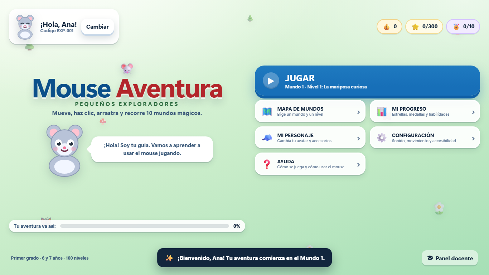
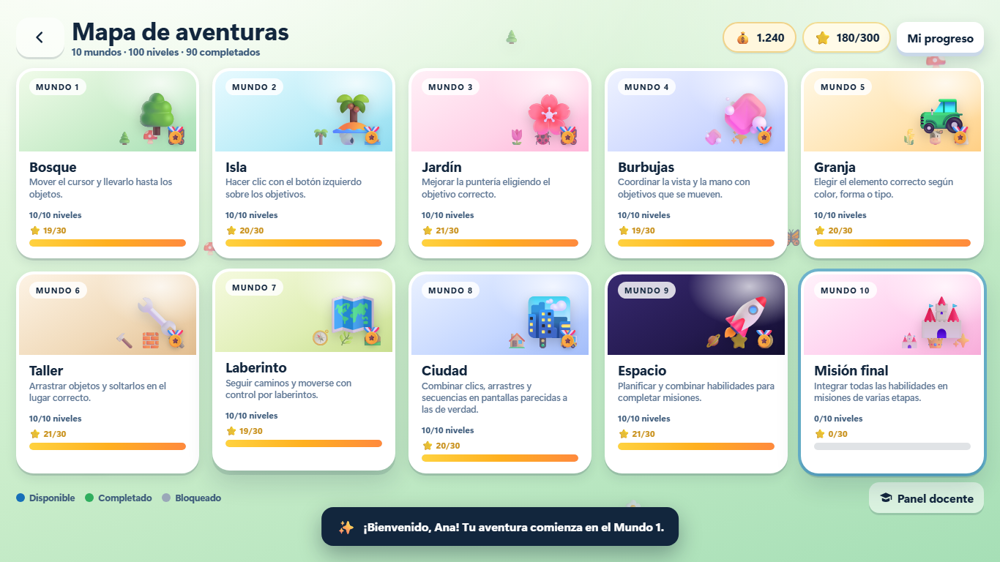

# Mouse Aventura: Pequeños Exploradores

Videojuego educativo **100 % web** para que niños y niñas de primer grado (6 y 7 años) aprendan a usar el mouse: moverlo, hacer clic, arrastrar, seguir caminos, resolver laberintos y combinar habilidades. No necesita instalación, cuentas, internet ni publicidad.



## Lo que incluye el juego

- **100 niveles jugables** repartidos en **10 mundos temáticos** (bosque, isla, jardín, burbujas, granja, taller, laberinto, ciudad, espacio y castillo).
- **7 plantillas de juego reutilizables** con más de 20 variantes: mover el cursor, clic, secuencias, arrastrar y soltar, rutas, laberintos, rueda del mouse y misiones combinadas.
- **Progresión real**: cada nivel se desbloquea al completar el anterior, se puede repetir y muestra su objetivo antes de empezar.
- **Evaluación pedagógica** con indicadores distintos según la actividad (precisión de clic, control del cursor, aciertos al soltar, control del recorrido…), estrellas y estados de habilidad: *en aprendizaje, en práctica, logrado y dominado*.
- **Recompensas**: monedas virtuales, estrellas, insignias por mundo, cofres, personajes desbloqueables y accesorios para el avatar. Sin compras ni cajas de pago.
- **Tutoriales interactivos** antes de cada mecánica nueva, botón de ayuda que adapta la dificultad y mensajes amables: nunca se castiga al niño por equivocarse.
- **Guardado automático** en `localStorage`, varios perfiles de estudiante y copia de seguridad exportable/importable.
- **Panel docente** protegido con PIN: estadísticas, perfiles con código, detalle por nivel, habilidades que necesitan refuerzo, exportación CSV, impresión de resúmenes y restablecimiento con confirmación.
- **Diploma final imprimible** de *Maestro o Maestra del Mouse*.
- **Accesibilidad**: botones grandes, objetivos ampliables, movimiento reducido, alto contraste, instrucciones con texto + imagen (nunca solo color), navegación opcional por teclado en los menús y juego completo con mouse.
- **PWA opcional**: se puede instalar y abrir sin conexión después de la primera carga cuando se sirve por HTTP/HTTPS.



## Cómo ejecutarlo

### Opción A: abrir directamente el archivo (la más rápida)

Haz doble clic en **`index.html`**. El juego usa JavaScript clásico y no necesita compilación ni servidor: funciona en Chrome o Edge desde el disco. En este modo el guardado local funciona, pero el navegador no permite instalar la PWA ni usar el service worker.

### Opción B: servidor local (recomendado)

Con Node.js instalado (no hace falta `npm install`: el servidor no tiene dependencias):

```bash
node tools/serve.cjs 8123
```

Abre <http://127.0.0.1:8123/> en Chrome o Edge.

También puedes usar cualquier servidor estático, por ejemplo:

```bash
python -m http.server 8123
```

En Windows, el docente puede hacer doble clic en **`iniciar-servidor.bat`**: arranca el servidor y abre el navegador automáticamente.

### Publicar en la red del colegio

Copia la carpeta completa en el servidor de la institución (IIS, Apache, Nginx o cualquier servidor de archivos estáticos) o ejecuta:

```bash
node tools/serve.cjs 8123 0.0.0.0
```

Los estudiantes abren `http://IP-DEL-SERVIDOR:8123/`. En este modo el juego funciona en red, pero la instalación como PWA y el modo sin conexión necesitan **HTTPS** (o `localhost`), porque los navegadores solo permiten service workers en contextos seguros. Para usar sin internet en el colegio, sirve el juego por HTTPS o instala la PWA en cada equipo desde un servidor local seguro.

### Instalar como aplicación (PWA)

1. Sirve el juego por HTTP (Opción B) o publícalo en la red interna del colegio.
2. En Chrome o Edge, usa el menú **Instalar aplicación** (icono de instalar en la barra de direcciones).
3. Después de la primera carga, el service worker guarda todos los archivos y el juego abre sin conexión.

> El modo `file://` no permite service workers. Para usar sin internet en el colegio, sirve los archivos desde un servidor local o instala la PWA.

## Cómo se juega

- Todo se juega **solo con el mouse**.
- Cada nivel muestra su objetivo, sus instrucciones y cuántas monedas y estrellas se pueden ganar.
- El botón **💡 Ayuda** explica de nuevo la tarea, señala el objetivo y hace la actividad un poco más fácil.
- El botón **⏸ Pausa** permite seguir, repetir, leer las instrucciones o volver al mapa. El progreso nunca se borra por salir de un nivel.
- Los niveles con reloj son opcionales: al acabarse el tiempo se puede continuar sin reloj.

## Los 10 mundos

| Mundo | Nombre | Objetivo principal |
|---:|---|---|
| 1 | El bosque de los primeros movimientos | Mover el cursor y llegar a los objetos (sin clics). |
| 2 | La isla de los clics mágicos | Hacer clic con el botón izquierdo. |
| 3 | El jardín de la precisión | Mejorar la puntería y elegir el objetivo correcto. |
| 4 | La fábrica de burbujas | Coordinación, objetivos en movimiento y velocidad controlada. |
| 5 | La granja de los animales | Selección y discriminación por color, tamaño y tipo. |
| 6 | El taller de los pequeños constructores | Arrastrar y soltar: piezas, torres, rompecabezas y clasificación. |
| 7 | El laberinto de los exploradores | Seguir caminos y resolver laberintos sin reiniciar el nivel. |
| 8 | La ciudad de los botones | Combinar clic, clic derecho, arrastre y secuencias en interfaces sencillas. |
| 9 | La aventura espacial | Precisión, planificación, rueda del mouse y misiones. |
| 10 | La gran misión del maestro del mouse | Misiones finales con todas las habilidades y diploma. |

El índice completo con los 100 niveles está en [`docs/NIVELES.md`](docs/NIVELES.md).

## Estructura del proyecto

```text
mouse-game/
├── index.html                  # Página principal (carga los módulos en orden)
├── manifest.webmanifest        # Configuración de la PWA
├── sw.js                       # Service worker (caché sin conexión)
├── assets/                     # Iconos SVG y PNG
├── styles/
│   ├── base.css                # Tokens, botones, modales, escenarios
│   ├── game.css                # Pantallas de menús, progreso, docente y diploma
│   ├── play.css                # HUD, escenario y plantillas de juego
│   └── print.css               # Impresión de resúmenes y diploma
├── src/
│   ├── core/                   # Utilidades, almacenamiento, audio, evaluación, progreso y estado
│   ├── data/                   # Mundos, habilidades, avatares y definiciones de niveles
│   │   └── levels/             # Un archivo de datos por mundo (w1…w10) + validador
│   ├── engine/                 # Motor de niveles, geometría de rutas y plantillas
│   │   └── templates/          # move, click, sequence, drag, path, wheel, mission
│   └── ui/                     # Componentes, tutorial y pantallas
├── tools/                      # Servidor local, iconos y generación de documentación
├── tests/                      # Pruebas unitarias Node, pruebas de navegador y capturas
└── docs/                       # Arquitectura, guía docente, pruebas e índice de niveles
```

## Pruebas y verificación

No hay dependencias de npm. Las pruebas usan Node.js y Chrome/Edge en modo headless mediante DevTools Protocol.

```bash
# 1. Pruebas unitarias de datos, progreso, evaluación y geometría (42 pruebas)
npm test

# 2. Servidor local para las pruebas de navegador
npm run serve       # http://127.0.0.1:8123

# 3. Recorrido automático de los 100 niveles (crea un perfil, juega y comprueba)
npm run smoke

# 4. Flujos de interfaz: pausa, repetir, ajustes, docente, CSV, impresión, recarga y PIN
npm run flows

# 5. PWA, modo sin conexión y arranque desde file://
npm run pwa

# 6. Arrastre con mouse real y apilado de las piezas
npm run drag

# 7. Accesibilidad básica (nombres accesibles, contraste, etiquetas)
npm run a11y

# 8. Capturas de todas las pantallas en 1366×768 y 1920×1080
npm run screens

# 9. Comprobación de integridad de archivos y referencias
npm run check
```

Resultados de la versión entregada:

- **42/42** pruebas unitarias correctas.
- **100/100** niveles completados en un recorrido automático, con desbloqueo progresivo, guardado y recarga.
- **34/34** comprobaciones de flujos de interfaz correctas.
- **11/11** comprobaciones de arrastre real (piezas, establos y apilado) correctas.
- **Sin errores de JavaScript** en consola durante las pruebas.

Los detalles y el procedimiento manual están en [`docs/PRUEBAS.md`](docs/PRUEBAS.md).

## Accesibilidad y diseño para niños

- Botones de al menos 54 px de alto y objetivos grandes en los primeros niveles; la opción **Objetivos más grandes** amplía los blancos.
- Instrucciones cortas, con dibujos, voz del personaje escrita y repetición siempre disponible.
- No se exige teclado ni doble clic; los tiempos son amplios y opcionales.
- Se evita depender solo del color: los objetos tienen formas, dibujos y nombres visibles cuando el color es la regla.
- Opción de **movimiento reducido**, **alto contraste** y **silencio total** con volúmenes independientes.
- Mensajes que valoran el esfuerzo y el progreso personal, nunca etiquetas negativas.
- El juego no pide datos personales: nombre o alias opcional y código interno.

## Privacidad y seguridad

- No hay cuentas, anuncios, compras, chats ni enlaces externos.
- Todo el progreso vive en el `localStorage` del navegador de ese computador.
- El botón **Panel docente** pide un PIN. El PIN inicial es **1234** y se recomienda cambiarlo. Es una **protección básica** contra entradas accidentales, no una medida de seguridad robusta: se guarda en el mismo equipo.
- Los docentes pueden exportar respaldos JSON y reportes CSV, e importar respaldos. No se simula sincronización entre computadores: si se necesita compartir progreso entre equipos haría falta un backend propio.

## Requisitos técnicos

- Chrome o Edge modernos (Chromium) en Windows 10 u 11 (también funciona en macOS/Linux con esos navegadores).
- Mouse convencional de dos botones y rueda (la rueda solo se usa en un nivel avanzado y tiene alternativa accesible).
- Resoluciones probadas: 1366 × 768 y 1920 × 1080; el diseño se adapta a pantallas más pequeñas.
- Sin dependencias externas ni servicios en la nube para jugar.

## Documentación

- [`docs/GUIA_DOCENTE.md`](docs/GUIA_DOCENTE.md) — uso en el aula, panel docente, reportes y recomendaciones pedagógicas.
- [`docs/ARQUITECTURA.md`](docs/ARQUITECTURA.md) — módulos, motor de niveles, fórmulas de evaluación, almacenamiento y cómo ampliar el juego.
- [`docs/PRUEBAS.md`](docs/PRUEBAS.md) — pruebas automáticas, resultados y lista de verificación manual.
- [`docs/NIVELES.md`](docs/NIVELES.md) — índice de los 100 niveles.

## Créditos

Diseño y desarrollo: proyecto educativo abierto de ejemplo. Ilustraciones y personajes originales dibujados en SVG dentro del propio código; sonidos generados con Web Audio API. Sin recursos externos.

Licencia: **CC BY-NC-SA 4.0** para uso educativo. Puedes adaptar el juego para tu colegio citando la fuente y compartiendo las mejoras con la misma licencia.
